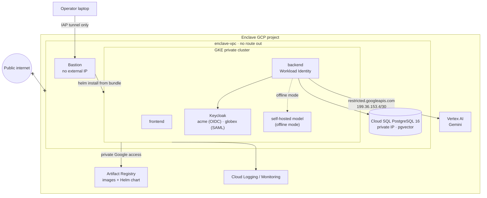
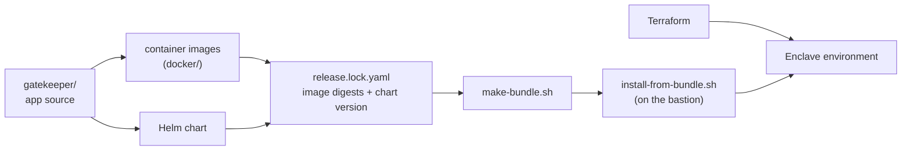

# gatekeeper-enclave

**Deploying [Gatekeeper](https://github.com/ghantasala-sr/GateKeeper) into a zero-egress Google Cloud environment: a private network where nothing inside can reach the public internet. Not one request.**


[](LICENSE)

[Gatekeeper](https://github.com/ghantasala-sr/GateKeeper) is the product: a multi-tenant AI assistant where Postgres row-level
security, not the model, decides what each person can see. This repo is the deployment: the infrastructure, packaging,
and evidence needed to run a specific Gatekeeper release inside an isolated environment, and to prove it stays isolated.

> **Status:** under construction. The sections below describe the target design; the [roadmap](#roadmap) tracks what exists.

---

## The constraint

> Everything runs inside the Enclave's private network. If it isn't already inside, it doesn't exist.

That rules out anything a normal deployment takes for granted: pulling images from Docker Hub, downloading models
from HuggingFace, calling a public AI API, signing in through a SaaS identity provider, or installing packages on a
server. Every image, model, chart, and tool arrives in a checksummed offline bundle.

## Architecture



| Control | How |
|---|---|
| **No route out** | VPC created without default routes; the only route is to Google's restricted API range (`199.36.153.4/30`). No Cloud NAT, no external IPs. |
| **Deny and log** | A `deny-all-egress` firewall rule with logging, so every attempt to leave is recorded. |
| **Private Google APIs** | Private DNS zones resolve `*.googleapis.com`, `*.pkg.dev`, and `gcr.io` to the restricted range. |
| **No keys** | Workload Identity for pods; no service account key files anywhere. |
| **In-cluster firewall** | Default-deny NetworkPolicies, enforced by Dataplane V2. |
| **Operator access** | IAP to a bastion; the cluster's API server has a private endpoint only. |
| **Optional fence** | VPC Service Controls perimeter around the project's Google APIs. |

## How this repo relates to Gatekeeper



- **`gatekeeper/`** is the application and nothing else: a snapshot of [GateKeeper](https://github.com/ghantasala-sr/GateKeeper) at `20615cb`, plus the app-code changes deployment needs (such as loading the embedding model from a path). Deployment files never go inside it.
- **Images and the Helm chart are built here** from the top-level `docker/` and chart folders, with `gatekeeper/` as the build context.
- **Everything else** is the environment: infrastructure, environment values, packaging, operational docs, and proof.
- **A release is pinned by digest** in `release.lock.yaml`, and the offline bundle packages exactly those images. Upgrading the Enclave is a reviewed change to that file.

## Repository layout

```
.
├── gatekeeper/              # the application source only (snapshot of GateKeeper 20615cb + app changes)
├── docker/                  # Dockerfiles (+ per-Dockerfile .dockerignore), built with gatekeeper/ as the context
├── release.lock.yaml        # the exact GateKeeper release to deploy
├── terraform/
│   ├── modules/             # network, firewall, dns, registry, iam, cloudsql, gke, bastion, vpc-sc, monitoring
│   └── envs/enclave/
├── config/
│   └── values-enclave.yaml  # environment settings layered on the chart's defaults
├── bundle/                  # make-bundle.sh, install-from-bundle.sh
├── proof/                   # zero-egress test, Terraform plan policy check, k6 load tests
├── labs/                    # local Kubernetes / Helm / Terraform groundwork (kind)
├── docs/
│   ├── DEPLOYMENT.md        # for the Enclave's platform team
│   ├── RUNBOOK.md           # install, upgrade, restore, rotate, respond to alerts
│   ├── TROUBLESHOOTING.md
│   └── drills/              # recorded results: drain, failover, restore, upgrade, game day
└── .github/workflows/       # terraform fmt/validate and the plan policy check
```

## Proof, not promises

Each claim gets evidence a reviewer can check:

| Claim | Evidence |
|---|---|
| Nothing inside can reach the internet | `curl https://google.com` and `https://api.anthropic.com` time out from a pod and from the bastion, and the firewall logs show both **DENIED** |
| The blueprint can't drift | CI reads `terraform show -json` and fails on any Cloud NAT, `0.0.0.0/0` route, external IP, public cluster endpoint, or public Cloud SQL IP |
| Gatekeeper's security still holds | Gatekeeper's test suite runs inside the Enclave on a throwaway database, and black-box access-matrix and prompt-injection checks run against the live deployment |
| It works fully offline | With Vertex AI permission removed, the self-hosted model still answers and still retrieves 0 forbidden passages |
| Upgrades don't drop requests | Upgrade and rollback between bundle versions during a k6 load test, with zero failed requests |
| Data can be recovered | A timed point-in-time restore drill against the recovery-time target |

## Roadmap

| Milestone | Scope | Status |
|---|---|---|
| **Groundwork** (local, kind) | Offline-ready images, model provider interface, Keycloak for both tenants, Kubernetes manifests, NetworkPolicies, Helm chart, Terraform basics | Planned |
| **Enclave** (GCP) | Sealed VPC, firewall, private DNS, bastion, Artifact Registry, private Cloud SQL, private GKE, offline bundle, zero-egress proof, CI plan check, offline mode, `DEPLOYMENT.md` | Planned |
| **Production** (GCP) | High availability, zero-downtime upgrades, backup and restore, observability with SLOs and an egress alert, Secret Manager CSI and key rotation, signed images and Binary Authorization, internal HTTPS Gateway, runbook and game day | Planned |

## License

[MIT](LICENSE)
