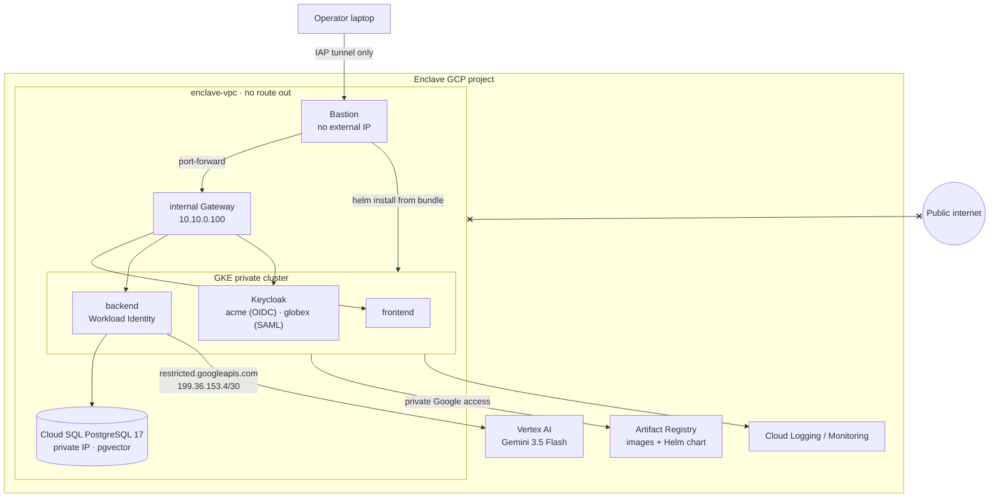
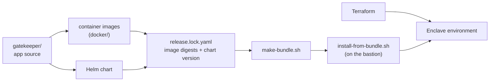

# gatekeeper-enclave

**Deploying [Gatekeeper](https://github.com/ghantasala-sr/GateKeeper) into a zero-egress Google Cloud environment: a private network where nothing inside can reach the public internet. Not one request.**


[](LICENSE)

[Gatekeeper](https://github.com/ghantasala-sr/GateKeeper) is the product: a multi-tenant AI assistant where Postgres row-level
security, not the model, decides what each person can see. This repo is the deployment: the infrastructure, packaging,
and evidence needed to run a specific Gatekeeper release inside an isolated environment, and to prove it stays isolated.

> **Status:** built, hardened and drilled on GCP (release 0.1.13). Zero egress is proven and alerted on. Gatekeeper's
> full test suite passes inside the Enclave, and Gemini answers through Google's restricted API range. Upgrades,
> rollbacks, node drains and a database failover run with no failed requests. Only signed images can run.
> Start with [`docs/DEPLOYMENT.md`](docs/DEPLOYMENT.md) (the platform team's guide) and
> [`docs/RUNBOOK.md`](docs/RUNBOOK.md) (on call); the evidence is in [`docs/drills/`](docs/drills/).

---

## The constraint

> Everything runs inside the Enclave's private network. If it isn't already inside, it doesn't exist.

That rules out anything a normal deployment takes for granted: pulling images from Docker Hub, downloading models
from HuggingFace, calling a public AI API, signing in through a SaaS identity provider, or installing packages on a
server. Every image, model, chart, and tool arrives in a checksummed offline bundle.

## Architecture



| Control | How |
|---|---|
| **No route out** | VPC created without default routes; the only route is to Google's restricted API range (`199.36.153.4/30`). No Cloud NAT, no external IPs. |
| **Deny and log** | A `deny-all-egress` firewall rule with logging, so every attempt to leave is recorded. |
| **Private Google APIs** | Private DNS zones resolve `*.googleapis.com`, `*.pkg.dev`, and `gcr.io` to the restricted range. |
| **No keys** | Workload Identity for pods; no service account key files anywhere. |
| **In-cluster firewall** | Default-deny NetworkPolicies, enforced by Dataplane V2. |
| **Operator access** | IAP to a bastion; the cluster's API server has a private endpoint only. |
| **Not yet: API fence** | A VPC Service Controls perimeter needs a Google Cloud Organization, which this project doesn't have; listed as a production requirement in [`DEPLOYMENT.md`](docs/DEPLOYMENT.md#known-limits-production-requirements). |

## How this repo relates to Gatekeeper



- **`gatekeeper/`** is the application and nothing else: a snapshot of [GateKeeper](https://github.com/ghantasala-sr/GateKeeper) at `20615cb`, plus the app-code changes deployment needs (such as loading the embedding model from a path). Deployment files never go inside it.
- **Images and the Helm chart are built here** from the top-level `docker/` and chart folders, with `gatekeeper/` as the build context.
- **Everything else** is the environment: infrastructure, environment values, packaging, operational docs, and proof.
- **A release is pinned by digest** in `release.lock.yaml`, and the offline bundle packages exactly those images. Upgrading the Enclave is a reviewed change to that file.

## Repository layout

```
.
├── gatekeeper/              # the application source only (snapshot of GateKeeper 20615cb + app changes)
├── docker/                  # Dockerfiles (+ per-Dockerfile .dockerignore), built with gatekeeper/ as the context
├── compose/                 # local stand-ins: Postgres with a Cloud SQL-like (non-superuser) owner, the sealed test
├── keycloak/                # realm imports: acme (OIDC, gk- groups) and globex (SAML); check_logins.py signs in all six
├── helm/gatekeeper/         # the Helm chart (values-local.yaml for kind); unittests/ run in CI
├── release.lock.yaml        # the exact GateKeeper release to deploy
├── terraform/
│   ├── bootstrap/           # project, billing, budget alerts, state bucket
│   ├── modules/             # network, firewall, dns, iam, secrets, cloudsql, gke, bastion, monitoring, tls, supplychain
│   └── envs/enclave/        # wires the modules together
├── config/
│   └── values-enclave.yaml  # environment settings layered on the chart's defaults
├── bundle/                  # make-bundle.sh (build machine), install-from-bundle.sh (bastion)
├── proof/                   # zero-egress proof, plan policy check, in-Enclave suite, black-box security checks
├── labs/                    # local Kubernetes / Helm / Terraform groundwork (kind)
├── docs/
│   ├── DEPLOYMENT.md        # for the Enclave's platform team
│   ├── RUNBOOK.md           # on call: install, upgrade, restore, rotate, alerts, troubleshooting
│   └── drills/              # every drill, with timings and what went wrong
└── .github/workflows/       # app tests (both owner types), frontend build, chart tests, Terraform fmt/validate, plan check
```

## Proof, not promises

Each claim gets evidence a reviewer can check. Results are from the Enclave on GCP, release 0.1.3:

| Claim | Evidence | Result |
|---|---|---|
| Nothing inside can reach the internet | `proof/prove-zero-egress.sh` tries Google, Anthropic, Hugging Face and PyPI from the bastion, from a pod under NetworkPolicies and from a pod with none. The VPC has no route out, so to show the firewall on its own it also sends a routable-but-forbidden request, which the firewall logs as **DENIED**. | All blocked; Google APIs still work; `deny-all-egress` DENIED logged |
| The blueprint can't drift | `proof/check_terraform_plan.py` reads `terraform show -json` and fails on any Cloud NAT, `0.0.0.0/0` route, kept default route, external IP, public GKE endpoint or nodes, or public Cloud SQL IP | 91 resources, no path out; 11 rule tests in CI |
| Gatekeeper's security still holds | `proof/suite-in-enclave.sh` runs the full suite inside the Enclave against real Cloud SQL on a throwaway database. `proof/blackbox_check.py` signs in all six users and runs the access matrix and three prompt injections against the live app and the real model. | 258 passed, 5 skipped; 21/21, nothing outside a user's tenant or clearance retrieved |
| Upgrades don't drop requests | `proof/upgrade-drill.sh`: upgrade and rollback between bundles under 20 req/s (k6); `proof/ha-drill.sh`: drain a node, fail Cloud SQL over | 0 failed requests through upgrade, rollback and drain; failover recovered with no restarts |
| Data can be recovered | `proof/restore-drill.sh`: delete a document's chunks, clone to the moment before, repair | RTO 24 min (target 60), RPO seconds |
| Only our images run | `proof/binauthz-drill.sh`: a modified image pushed under the release's own tag | denied by Binary Authorization, and in the audit log |
| Leaks are noticed | an egress attempt from a pod | the "egress attempt" alert fired ~3½ min later |

Before any cloud spend, the same properties were proven locally:

- **`compose/sealed-test.sh`:** runs the whole stack on a Docker network with no route out, against a Cloud SQL-like
  owner that is neither superuser nor `BYPASSRLS`. Chat returns a clean 503 there, because Vertex AI can't be reached.
- **On kind:** with Calico enforcing NetworkPolicies, the Helm chart installs and passes `helm test`, and all six
  users sign in through the Gateway.

## Roadmap

| Milestone | Scope | Status |
|---|---|---|
| **Groundwork** (local, kind) | Offline-ready images, model provider interface, Keycloak for both tenants, Kubernetes manifests, NetworkPolicies, Helm chart, Terraform basics | Done |
| **Enclave** (GCP) | Sealed VPC, firewall, private DNS, bastion, Artifact Registry, private Cloud SQL, private GKE, offline bundle, zero-egress proof, CI plan check, `DEPLOYMENT.md` | Done (VPC Service Controls needs an Organization) |
| **Production** (GCP) | High availability, zero-downtime upgrades, backup and restore, observability with SLOs and an egress alert, Secret Manager CSI and key rotation, signed images and Binary Authorization, internal HTTPS Gateway, runbook and game day | Done (Keycloak HA remains, see `DEPLOYMENT.md`) |

## License

[MIT](LICENSE)
