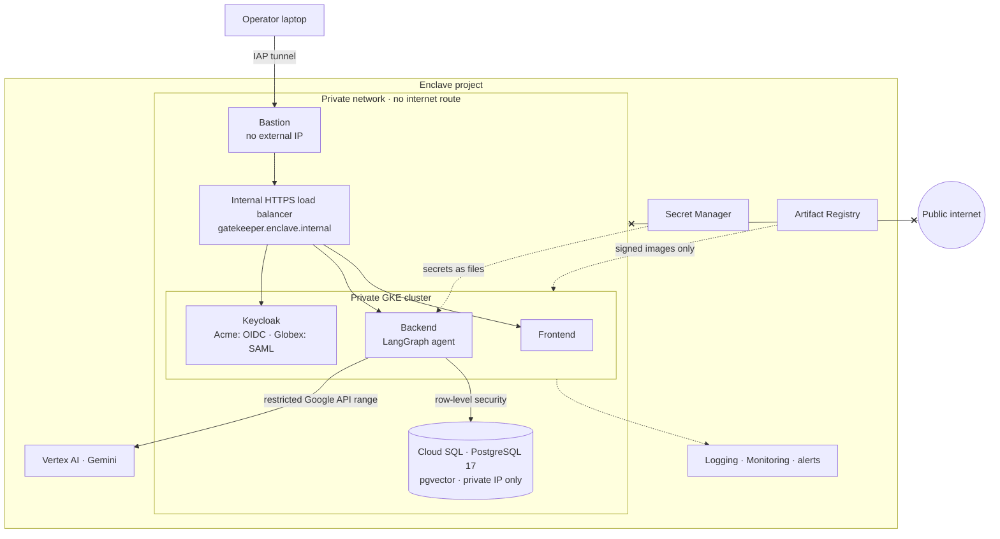
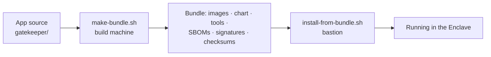

# gatekeeper-enclave

**Gatekeeper, running in a sealed Google Cloud environment where nothing inside can reach the public internet.**


[](LICENSE)

[Gatekeeper](https://github.com/ghantasala-sr/GateKeeper) is a multi-tenant AI assistant for company documents.
PostgreSQL row-level security, not the AI model, decides what each person can see.

This repository deploys it into an **Enclave**: a private GCP network with no route to the internet. It covers the
infrastructure, the offline packaging, the operations, and the evidence that the deployment stays sealed and secure.

---

## What the Enclave guarantees

| | How |
|---|---|
| **Nothing gets out** | The network has no internet route, no NAT and no external IPs. Its only way out is Google's restricted API range. A deny-all egress firewall logs every attempt, and an alert fires on any of them. |
| **The AI stays inside Google** | Gemini on Vertex AI, reached privately through that restricted range. Only the passages a user is cleared to read are ever sent to the model. |
| **Each tenant sees only its own data** | Row-level security in the database. A model, a prompt or a compromised agent can't widen what the database returns. |
| **No stored credentials** | Pods use Workload Identity; there are no service-account keys. Secrets come from Secret Manager, mounted as files, and are never copied into Kubernetes. |
| **Only our images run** | Images are signed when they're built and deployed by digest. GKE's Binary Authorization refuses anything else. |
| **Encrypted, private entry** | HTTPS at an internal load balancer, from a private CA. Operators reach it only through IAP and a bastion, and nothing has a public endpoint. |
| **Least privilege inside the cluster** | Default-deny network policies: each pod can reach only what it needs. Non-root containers, all capabilities dropped. |

## Architecture



## How a release gets in

The Enclave can't download anything, so every release arrives as one checksummed **offline bundle**.



1. **The build machine** builds the images, records each one's digest, generates an SBOM, and signs every digest.
2. **On the bastion**, the installer verifies the checksums and pushes the images. It checks that each pushed
   digest matches the signed one, uploads the signatures, and installs the Helm chart by digest.
3. **Database migrations** run before the new pods start, and only ever add to the schema. Upgrades and rollbacks
   don't drop requests.

## Evidence

Every claim was tested on the running Enclave. The scripts are in [`proof/`](proof/), and timings and findings are
in [`docs/drills/`](docs/drills/).

| Claim | Test | Result |
|---|---|---|
| Nothing reaches the internet | Google, Anthropic, Hugging Face and PyPI, from the bastion and from pods | all blocked; the firewall logs the denials; Google APIs still work |
| Any escape attempt is noticed | an egress attempt from a pod | alert raised ~3½ minutes later |
| The infrastructure can't drift open | a check of every Terraform plan, in CI | fails on any NAT, internet route, external IP or public endpoint |
| Tenant isolation holds | Gatekeeper's full test suite inside the Enclave, plus live checks for all six test users with the real model, including prompt injections | 258 tests passed; 21/21 live checks, nothing outside a user's tenant or clearance |
| Upgrades don't drop requests | upgrade and rollback under load | 0 failed requests |
| Losing a node or the database primary doesn't take it down | node drain under load; Cloud SQL failover | 0 failed requests; recovered with no restarts |
| Data can be recovered | point-in-time restore after a deletion | recovered in 24 minutes, with seconds of data lost |
| Only signed images run | a modified image pushed under the release's own tag | refused, and logged |
| Keys rotate without logouts | signing-key rotation | existing sessions kept working |
| Operators can recover fast | three failures at once, fixed using only the runbook | fixed in under 12 minutes |

## Known limits

- **Keycloak runs as a single replica.** Making it highly available needs its own database and clustering.
- **VPC Service Controls aren't in place.** They need a Google Cloud Organization, which this project doesn't
  have. The network is still zero-egress.
- **The private CA is a Terraform-managed key.** Production would use Certificate Authority Service.

The details are in [`docs/DEPLOYMENT.md`](docs/DEPLOYMENT.md#known-limits-production-requirements).

## Documentation

| Document | For |
|---|---|
| [`docs/DEPLOYMENT.md`](docs/DEPLOYMENT.md) | The platform team: the security review's questions answered, installing from an empty project, operator access |
| [`docs/RUNBOOK.md`](docs/RUNBOOK.md) | On call: upgrade, roll back, restore, rotate, respond to each alert, troubleshoot |
| [`docs/drills/`](docs/drills/) | The record of every drill: what was tested, timings, and what went wrong |

## Repository layout

```
.
├── gatekeeper/            the application source (backend, frontend); no deployment files
├── docker/                Dockerfiles, built with gatekeeper/ as the context
├── helm/gatekeeper/       the Helm chart, with unit tests
├── config/                Enclave settings (values-enclave.yaml) and the private CA's certificate
├── terraform/             bootstrap (project, budget, state) and the Enclave's infrastructure modules
├── bundle/                build the offline bundle; install it on the bastion
├── keycloak/              identity provider realms for the two test companies
├── proof/                 the evidence: zero-egress, security, upgrade, failover, restore and supply-chain checks
├── docs/                  deployment guide, runbook, drill records
├── compose/               a local sealed-network test with Docker
├── labs/                  local Kubernetes groundwork on kind
├── release.lock.yaml      the release to deploy
└── .github/workflows/     CI: app tests, chart tests, Terraform checks
```

## License

[MIT](LICENSE)
